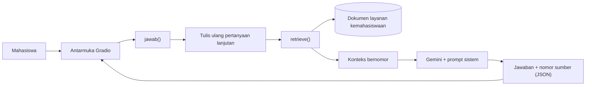

# Chatbot Layanan Kemahasiswaan Berbasis LLM

Big Project *LLM-Based AI Chatbot Development*. Chatbot berbasis LLM (Gemini) yang menjawab pertanyaan mahasiswa seputar layanan kemahasiswaan: beasiswa, prosedur akademik, administrasi, dan kegiatan kemahasiswaan.

> Status: bagian chatbot dan antarmuka sudah berjalan dengan **data contoh**. Retrieval dokumen asli (bagian Data & RAG) sedang dikerjakan. Tanda `[isi]` menandai bagian yang harus dilengkapi tim.

## Tujuan dan target pengguna

- **Masalah:** informasi layanan kemahasiswaan tersebar di banyak dokumen sehingga mahasiswa sulit mencarinya dan staf sering menjawab pertanyaan yang sama.
- **Tujuan:** menyediakan asisten tanya jawab yang menjawab berdasarkan dokumen resmi dan menyebut sumbernya.
- **Pengguna:** mahasiswa aktif dan mahasiswa baru.
- **Cakupan topik:** `[isi: 4-5 topik yang disepakati tim]`

## Fitur

- Chat interface berbasis web (Gradio) yang terintegrasi dengan Gemini.
- Jawaban hanya berdasarkan konteks dokumen (pendekatan RAG), disertai nama sumber.
- Menolak dengan sopan pertanyaan di luar topik dan mengaku tidak tahu jika informasi tidak ada, tanpa mengarang.
- Memahami pertanyaan lanjutan (mis. "Kalau pendaftarannya kapan?") melalui penulisan ulang pertanyaan berdasarkan riwayat percakapan.
- Sumber hanya ditampilkan jika benar-benar dipakai untuk menjawab.
- Pesan error yang ramah, termasuk saat kuota API habis.

## Arsitektur dan alur kerja



Langkah untuk satu pertanyaan:

1. Pengguna mengirim pertanyaan lewat antarmuka chat.
2. Jika ada riwayat percakapan, pertanyaan ditulis ulang menjadi pertanyaan lengkap.
3. `retrieve()` mengambil potongan dokumen yang relevan beserta nama sumbernya.
4. Potongan diberi nomor, lalu dikirim ke Gemini bersama prompt sistem.
5. Gemini mengembalikan JSON berisi `jawaban` dan `nomor_sumber`.
6. Antarmuka menampilkan jawaban dan hanya sumber yang dipakai.

## Teknologi

| Komponen | Teknologi |
|---|---|
| LLM | Google Gemini (`gemini-3.1-flash-lite`) lewat paket `google-genai` |
| Antarmuka | Gradio (`gr.ChatInterface`) |
| Retrieval | `[isi: embedding, vector database, chunking]` |
| Bahasa | Python 3.12 |
| Lingkungan | Notebook Jupyter di PyCharm, virtual environment `.venv` |

## Struktur proyek

```
project_sains/
├── Final_Project_Data_Sains.ipynb   # notebook utama (setup, prompt, jawab(), antarmuka, uji)
├── uji_prompt_v1.csv                # hasil uji prompt versi 1
├── .env                             # API key (tidak di-commit)
├── .gitignore
├── requirements.txt
└── README.md
```

`[isi: tambahkan folder rag/ dan eval/ jika tim memisahkannya]`

## Instalasi

```bash
git clone [isi: alamat repositori]
cd project_sains
python3 -m venv .venv
source .venv/bin/activate          # Windows: .venv\Scripts\activate
pip install -r requirements.txt
```

Isi `../Downloads/requirements.txt` yang dipakai:

```
google-genai==3.0.0
langchain==1.4.9
gradio==6.32.0
python-dotenv
pandas
pydantic
ipykernel
```

## Konfigurasi

1. Buat API key Gemini di Google AI Studio.
2. Buat file `.env` di folder proyek:

```
GEMINI_API_KEY=isi_key_anda
```

Jangan memberi tanda kutip atau spasi di sekitar `=`, dan jangan pernah meng-commit file `.env`.

## Cara menjalankan

1. Buka `Final_Project_Data_Sains.ipynb`.
2. Pilih interpreter `.venv`.
3. Jalankan semua sel dari atas ke bawah.
4. Buka alamat lokal yang tampil pada keluaran sel Gradio (biasanya `http://127.0.0.1:7860`).

Jika ingin menjalankan ulang antarmuka, jalankan `demo.close()` lebih dulu agar port tidak bentrok.

## Penggunaan fungsi `jawab()`

```python
hasil = jawab("Apa syarat beasiswa prestasi?")
hasil["jawaban"]             # teks jawaban
hasil["sumber"]              # daftar nama sumber yang dipakai (kosong jika menolak)
hasil["pertanyaan_mandiri"]  # pertanyaan setelah dilengkapi dari riwayat
```

Dengan riwayat percakapan: `jawab(pertanyaan, riwayat)`, dengan `riwayat` berupa daftar pesan berformat `{"role": ..., "content": ...}`.

## Prompt sistem dan pengurangan halusinasi

Strategi yang dipakai:

- Jawaban dibatasi pada konteks yang diberikan.
- Jika informasi tidak ada, bot menyatakan belum memiliki informasinya dan mengarahkan ke layanan kemahasiswaan.
- `temperature` rendah (0,2) agar jawaban stabil.
- Keluaran terstruktur (JSON) dengan `nomor_sumber` sehingga sumber yang tampil hanya yang dipakai.
- Pengujian terhadap pertanyaan sulit: informasi yang tidak tersedia, upaya mengubah peran bot, dan permintaan membocorkan prompt.

Riwayat versi prompt:

| Versi | Perubahan | Hasil uji (benar dari 10) |
|---|---|---|
| v1 | Aturan dasar, keluaran JSON bersumber | `[isi dari uji_prompt_v1.csv]` |

## Hasil pengujian dan evaluasi

`[isi: ringkasan dari anggota yang memegang evaluasi]`

- Jumlah pertanyaan uji: `[isi]`
- Metrik: ketepatan jawaban, faithfulness terhadap konteks, relevansi retrieval, waktu respons `[sesuaikan]`
- Perbandingan tanpa RAG dan dengan RAG: `[isi]`

## Keterbatasan

- Selama retrieval masih memakai data contoh, jawaban hanya sebagus data tersebut.
- Chatbot hanya mengetahui isi dokumen yang dimasukkan, sehingga informasi yang tidak ada atau sudah kedaluwarsa tidak dapat dijawab.
- Tier gratis API memiliki batas jumlah permintaan.
- Jawaban chatbot bukan keputusan resmi; untuk urusan penting mahasiswa tetap perlu memastikan ke layanan kemahasiswaan.

## Tim

| Peran | Nama | Tanggung jawab |
|---|---|---|
| Data & RAG | `[isi]` | Pengumpulan dokumen, chunking, embedding, retrieval |
| Chatbot & Antarmuka | `[isi]` | Integrasi Gemini, prompt sistem, `jawab()`, antarmuka chat, dokumentasi |
| Evaluasi & Poster | `[isi]` | Dataset uji, evaluasi, poster ilmiah |

## Referensi

- Dokumentasi Gemini API: https://ai.google.dev/gemini-api/docs
- Dokumentasi Gradio: https://www.gradio.app/docs
- `[isi: dokumen sumber dan referensi ilmiah tentang RAG]`
